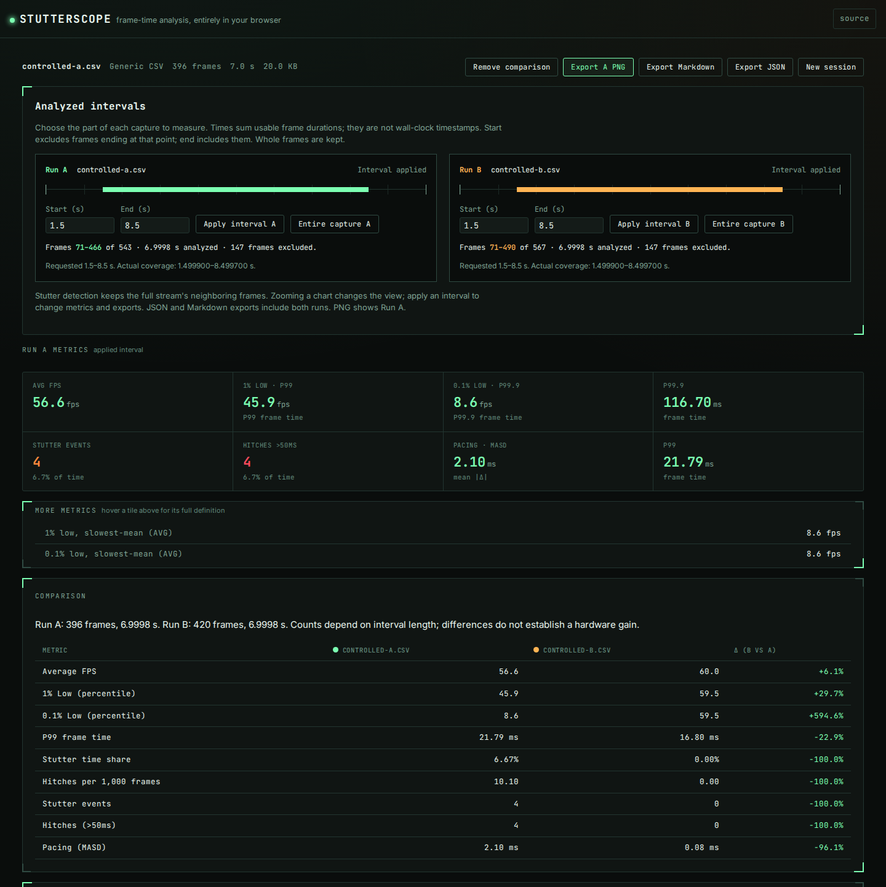
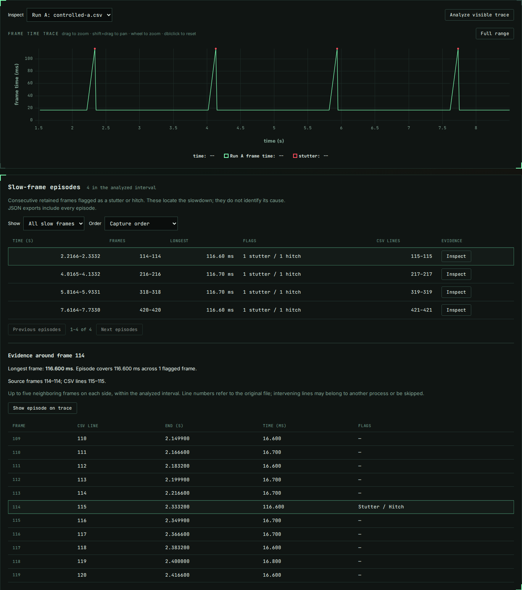

# Compare the part of the capture you meant to measure

Interval analysis, slow-frame inspection, and the `compare` CLI command are
**unreleased source-checkout features**. The existing hosted site and published
npm package do not acquire these changes until a release.

A loading screen can dominate a frame-time percentile even when the scene being
measured is smooth. Zooming a chart helps find that boundary, but does not by
itself change a statistic. Stutterscope now lets you select the frames used by
the metrics, inspect the slow frames, and export the exact selection.

## Try a measured example

From the repository root:

```sh
npm ci
npm run build
npm run preview
```

Open the local URL and choose **Open recorded comparison**. This loads two
retained `requestAnimationFrame` captures, with the 1.5–8.5 s scene interval
applied to each. Both have deliberate startup and tail work; Run A also has
four deliberate blocking tasks in the scene. The frame intervals were measured
in Chromium, not generated from target durations. They are a controlled local
browser experiment, not a game capture or evidence of a hardware improvement.
[Workload, capture metadata, and reproduction](../examples/controlled-browser/README.md).

The retained scene contains 396 frames and four slow-frame episodes in A,
versus 420 frames and no episodes in B. Its average frame rate is approximately
56.57 versus 60.00 fps. The independent
[NumPy check](../scripts/verify-intervals.py) reads the CSV values directly and
checks both full captures and two selected intervals, including the source
positions of all slow episodes.



1. Change either run's **Start** or **End**, then apply its interval. A blank
   end includes the rest of the capture. Draft edits leave the existing report
   and exports available. **Entire capture** restores that run's full stream.
2. Choose A or B in **Inspect** above the trace. This changes the trace, FPS
   chart, and episode inspector; the comparison always includes both runs.
3. Inspect an episode to see the original frame numbers, CSV lines, durations,
   and up to five neighbors on each side of the longest frame. Available
   CPU/GPU busy time and display-latency channels appear alongside them.
4. **Show episode on trace** zooms the chart. **Analyze visible trace** applies
   the visible time bounds to that run's metrics. These are separate actions.
5. Export JSON or Markdown for both runs. PNG remains a card for Run A and says
   which interval it represents. Exports always use the last completed analysis.

An invalid or empty interval preserves the previous analysis. **Cancel analysis**
terminates pending work. If a worker fails, retry reloads the original file,
format, column mapping, stream, and requested interval. Changing a source or
present stream starts with that new source's entire capture.

## Exactly which frames are selected

The timeline is **accumulated usable frame time**, starting at zero for the
selected present stream. It is not a source wall-clock timestamp. Rows skipped
by the parser have no duration added to this timeline; missing time is not
reconstructed. A generic cumulative-timestamp mapping first derives a duration
from consecutive usable timestamps, as described in [formats](formats.md).

A frame is selected when its ending time is **after start and at or before end**.
Zero-duration frames at the origin are included when start is zero. This assigns
equal endpoints to the preceding interval instead of double-counting them in
adjacent selections. End beyond the capture includes the available tail; the
requested bound is still retained in the report.

Frames are never clipped or assigned fractional weights. If a 200 ms frame
starts at 0.1 s and ends at 0.3 s, selecting 0.11–0.31 s keeps that whole frame.
The actual coverage can therefore start before the requested start. The interface
and JSON show both requested bounds and actual coverage, selected frame numbers,
and exclusions. Average FPS divides selected frame count by the sum of selected
durations, not by the requested interval width or the original end timestamp.

Compensated timeline accumulation and a four-machine-epsilon comparison tolerance
handle arithmetic rounding at decimal boundaries. They do not round or resample
the source frame durations. A one-frame interval has no successive pair from
which to measure pacing variability: MASD is unavailable, serialized as `null`.

## Detection context and episodes

The rolling-median detector always sees the **full selected present stream**,
including neighboring frames outside the interval. Its flags are then counted
within the chosen interval. Cropping tightly around an existing stutter cannot
make the rolling median rise to that stutter's own duration and erase its flag.
Changing detection settings recomputes both runs using their existing intervals.

Average FPS, percentiles, lows, MASD, and optional-channel summaries use only
selected frames. MASD uses pairs entirely inside the interval. No duration is
weighted by the fraction of a frame that overlaps a bound.

An episode is a consecutive sequence of retained frames that meet the stutter
rule, the absolute hitch threshold, or both. A stutter count remains a **frame
count**, not an episode count. Each episode records both counts, total frame
time, its longest frame, original frame numbers, and first/last CSV lines.
An episode touching a trimmed boundary is labeled because it may continue
outside the selection. Skipped rows or interleaved processes can occur between
the reported source lines; the line range does not claim every intervening row
belongs to that episode. This is a place to investigate, not a cause classifier.



The table shows 20 episodes per page. Ordering and filtering only affect the
table; every episode remains in the JSON export. Frame context is limited to 11
rows around the longest frame. On a phone the episode table keeps time, longest
frame, and Inspect visible; the inspector carries the original frame/line ranges.

Comparisons list the analyzed frame count and duration for each run. Raw event
counts depend on exposure, so the table also shows stutter time share and hitches
per 1,000 frames. Overlaid histograms show percentages of each run's selected
frames. Choosing intervals does not align scenes automatically, establish a
common workload, remove run-to-run variation, or create a confidence interval.

## Terminal workflow

`npm ci` builds the local executable. These commands use that source build:

```sh
node dist-cli/cli/index.js summary examples/controlled-browser/controlled-a.csv \
  --start 1.5 --end 8.5 --events

node dist-cli/cli/index.js compare examples/controlled-browser/controlled-a.csv \
  examples/controlled-browser/controlled-b.csv --start 1.5 --end 8.5

node dist-cli/cli/index.js compare examples/controlled-browser/controlled-a.csv \
  examples/controlled-browser/controlled-b.csv \
  --a-start 2.2 --a-end 2.34 --b-start 1.5 --b-end 8.5 --json > comparison.json
```

`--start`, `--end`, and `--stream` apply to both comparison inputs by default.
`--a-start`, `--a-end`, `--a-stream`, and their `--b-*` equivalents override a run
independently. Format detection is independent for each file. `--format` and
generic-column overrides, when supplied, apply to both inputs. Detection settings
are shared. Comparisons are descriptive and exit zero when successfully computed;
invalid inputs/ranges exit one. There is no regression threshold or CI gate.

`--events` lists the first 20 episodes per run in terminal output. A comparison
with `--json` includes all episodes for both runs. For the existing `summary`
command, add `--events --json` to include episodes. Summary JSON retains its
existing top-level `summary` key.

## Export coordinates and limits

Browser reports and the comparison CLI use schema version 3. A single browser
report contains `source`, `analysis`, `metrics`, and `episodes`. A comparison
contains two such reports at `runs.a` and `runs.b`. Both record applied detection
settings, generic mapping, selected stream, source warnings, and interval rules.

| Field | Meaning |
| --- | --- |
| `source.frameCount`, `source.durationSec` | Full parsed stream, before interval selection |
| `metrics.frameCount`, `metrics.durationSec` | Analyzed frames and their summed duration |
| `analysis.selection.requested` | Requested bounds; `null` for Entire capture |
| `firstFrameIndex`, `lastFrameIndex` in the selection | Zero-based inclusive indices in the full parsed stream |
| `metrics.stutter.stutterFrameIndices` | Zero-based indices inside the analyzed selection; add `firstFrameIndex` to locate them in the full stream |
| Episode `firstFrame`, `lastFrame`, `longestFrame` | One-based frame numbers in the full parsed stream |
| Episode `firstSourceLine`, `lastSourceLine` | One-based physical CSV lines; `null` for a caller-created series without line references |
| `touchesSelectionStart`, `touchesSelectionEnd` | A possible continuation beyond a trimmed boundary, not a proven complete episode |

MangoHud reports additionally retain `source.timingEvidence`, describing the
elapsed-clock cross-check and the required per-frame logging assumption. See
[format evidence and limitations](formats.md#mangohud).

For a cumulative-timestamp mapping, a source line identifies the ending sample;
its frame duration is derived from the preceding usable timestamp. Source warnings
and skipped-row totals describe the entire input, not just the selected interval.

Reports do not bundle the full CSV or authenticate it. Retain the original file
to inspect rows not shown in the report. File names, stream names, column names,
and parser warnings remain in exports; these are not anonymized reports.

The worker caches the full parsed stream to retain detection context and to allow
restoring Entire capture without another import. Interval analysis, episode
discovery, and exports still need memory/work proportional to input size. Table
paging limits the rendered rows; it is not a file-size or memory limit. Browser
tests cover Chromium and Firefox; no physical gaming rig or Safari claim follows
from the controlled browser capture.

The [verification record](verification-intervals-2026-10-07.md) links the exported
comparison, independent arithmetic, screenshots, and package checks from this
implementation.
