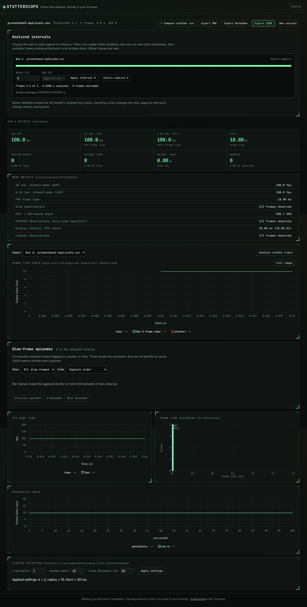
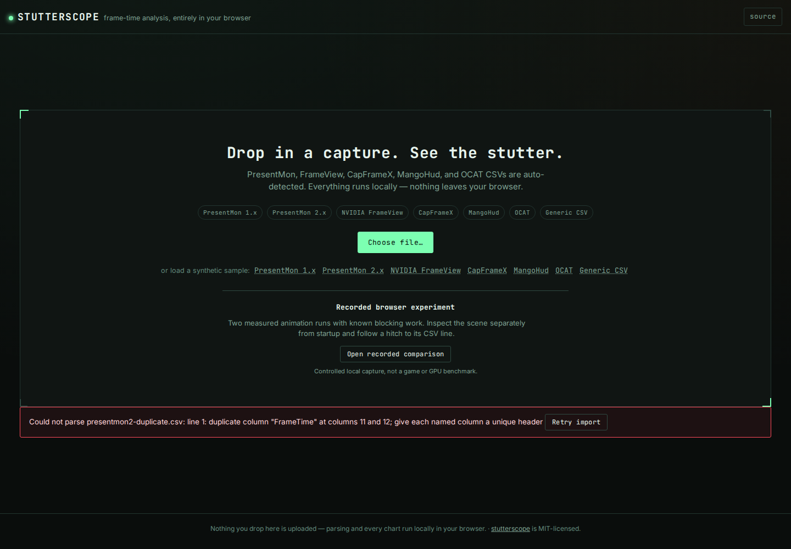

# CSV ambiguity can change an FPS report without changing the capture

At source baseline `a45907d`, Stutterscope silently used the first occurrence
of a header name. A capture with two `FrameTime` columns containing 10 and
100 therefore reported **100 FPS**, with no warning; selecting the other
column would produce **10 FPS**. Neither choice is justified by the file.
The quoted-field reader also removed misplaced quotes: `1"00"` became a
100 ms frame and created a hitch.

Source commit `21fe7ba` rejects these inputs before producing metrics.
Errors identify physical lines and fields (or both duplicate column positions).
These changes are not an npm release. All examples here are constructed
counterexamples, not evidence that a capture tool emits malformed files.

## What the actual CLI did

[`replay.py`](replay.py) runs the compiled or installed executable as a child
process. It checks exit codes, empty stdout on errors, frame counts and FPS
for valid controls. The retained results include input hashes, the hash of
the entire compiled JavaScript tree, and the runtime version.

| Input | Baseline `a45907d` | Corrected source and installed CLI |
|---|---|---|
| Two `FrameTime` columns, 10 and 100, two rows | 100 FPS, zero hitches, no warning | Error: duplicate column at positions 11 and 12 |
| A 10 ms frame followed by `1"00"` | 18.18 FPS, one 100 ms hitch | Error: unexpected quote at line 3, field 2 |
| Text after a closing quote / unclosed final field | Accepts both files | Refuses both files |
| Quoted field spanning two physical lines | Skips part of the record and reports the remaining frame | Explicit unsupported-multiline error |
| Quoted commas and doubled quotes, quoted numbers, empty header padding, generic named mapping, CapFrameX metadata, ragged OCAT hardware fields | All six controls parse | Same frame counts and FPS |

The duplicate-header cases cover all seven parser choices: PresentMon 1/2,
FrameView, OCAT, CapFrameX, MangoHud, and an explicitly mapped generic CSV.
One additional case duplicates `GPUBusy`, since choosing between conflicting
telemetry columns is as ambiguous as choosing a timing column.

Across [18 retained cases](cases.json), the [baseline](results/before.json)
accepts all 12 inputs that should be refused. The [corrected build](results/after.json)
refuses those 12 and preserves all six valid controls. A newly installed
tarball is replayed on Node 26.7.0 and the declared minimum Node 22.6.0:
[current runtime](results/installed.json), [minimum runtime](results/installed-node22.json).

## Compatibility with existing captures

The [existing capture manifest](../real-captures/manifest.json) pins the exact
upstream revisions and SHA-256 values. All 37 cached files were hash-checked;
three summary files are not per-frame inputs, leaving 34 for the CLI replay.
This is a convenience corpus, including 18 PresentMon gold fixtures, not a
representative sample of damaged files or all capture-tool versions.

| Replay outcome | Before | After |
|---|---:|---:|
| Parsed files | 27 | 27 |
| Refused files | 7 | 7 |
| Changed frame counts, durations, metrics, warnings, or rejection messages | -- | 0 |

The seven refusals are the existing unsupported Afterburner files and periodic
MangoHud logs. No new refusal appeared in this corpus. See
[before](results/corpus-before.json) and [after](results/corpus-after.json).
This comparison checks compatibility; it does not independently establish that
every chosen column represents the intended physical measurement.

## Browser behavior

[`observe-browser.mjs`](observe-browser.mjs) opens the actual production build,
uploads the same duplicate-column file, and downloads JSON if a report exists.
It does not replace the DOM, parser, or worker responses. The baseline exported
100 FPS at both 1440 px and 375 px. The corrected build exposes the conflicting
header and offers retry, with no fabricated report.




[Phone before](../../docs/assets/csv-integrity/before-375.png) and
[phone after](../../docs/assets/csv-integrity/after-375.png) show the same behavior.
The captures were visually inspected. The retained
[before observation](results/browser-before.json) includes the actual downloaded
JSON; the [after observation](results/browser-after.json) includes the error text.
Neither observation found horizontal overflow, external requests, page errors,
or axe WCAG 2 A/AA and 2.1 AA violations at either width. Automated accessibility
checks do not establish complete accessibility.

Chromium and Firefox checks also exercise retry, loading a corrected capture,
and downloading its report. A failed replacement keeps the previous valid
capture's identity, metrics, and export; only the export timestamp changes.

## Boundaries and verification

- Named columns are compared case-sensitively after trimming. Duplicate empty
  padding headers remain allowed. Duplicates are rejected even if their values
  happen to agree; choosing a name would still have two possible meanings.
- Each record must occupy one physical line. Quoted commas, doubled literal
  quotes, and surrounding spaces/tabs are supported. Full multiline CSV is
  explicitly unsupported; the parser must not manufacture frames from record
  fragments. These are capture parsers, not a general spreadsheet importer.
- CapFrameX comment metadata and MangoHud's preamble are handled separately.
  OCAT does not need repeated hardware fields on later rows. Validly structured
  rows with missing numeric cells retain existing skipped-row/unknown behavior.
- Detection samples may end inside a quoted field. Detection does not validate
  an incomplete record; the selected parser validates complete records.
- Streaming parse failures cancel unread input and release the reader lock.
  Whole-text and byte-by-byte streamed reads agree on every controlled case.

The clean archive of `21fe7ba` was installed with `npm ci`, then checked with
lint, TypeScript, 241 tests, a production build, and 64 browser checks across
Chromium and Firefox. The tarball was produced there and installed in a separate
directory. No package version was bumped or registry release made.

## Reproduce

```bash
npm ci
python3 -I studies/csv-integrity/replay.py dist-cli/cli/index.js --label checkout
python3 -I studies/csv-integrity/replay.py dist-cli/cli/index.js --label checkout --corpus
npm run test:browser
```

The corpus command needs the hash-pinned cache; obtain it with
`python3 -I studies/real-captures/fetch.py` if absent. The counterexamples need
no downloads beyond the project's normal dependencies. To replay the baseline,
build `a45907d` in a separate checkout and pass its compiled CLI to the same
runner. For installed verification, pass the installed package's
`dist-cli/cli/index.js` and optionally `--node /path/to/node-v22.6.0/bin/node`.

Browser captures use `npm run build` and `npm run preview -- --host 127.0.0.1`;
pass that local URL and `after` to `observe-browser.mjs` (use the baseline's
preview and `before` for the comparison).
