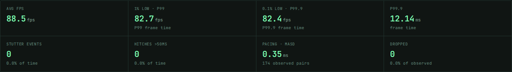
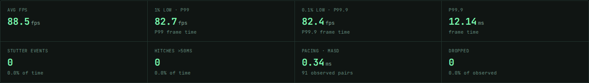
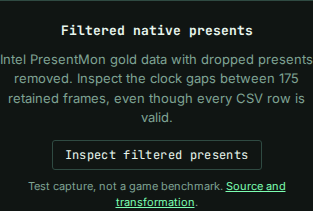

# Valid CSV rows can still conceal missing presents

Baseline `8728c17` treated every pair of retained native frames as adjacent
unless a malformed row interrupted them. PresentMon's documented
[`-exclude_dropped` option](https://github.com/GameTechDev/PresentMon/blob/v1.9.2/README.md#command-line-options)
deliberately removes presents without leaving malformed rows. The remaining
native timestamps and frame durations can expose the interruption.

There is also a direct counterexample in an untouched public FrameView 1.6
capture (`re4.exe`). Its source line 49,061 advances from `317.416092` to
`317.425341` seconds: **9.249 ms**, while that retained frame reports **4.439 ms**.
The discrepancy exceeds their written rounding precision. The old analyzer
joined those frames anyway. The [five unchanged rows](fixtures/frameview-native-excerpt.csv)
and their original positions/hashes in [the manifest](cases.json) retain this
case without redistributing the full 57 MB file. Filtering, missing records or
clock behavior may explain it; no cause or missing-frame count is inferred.

The correction compares the native present clock within each recognized stream.
It marks a known boundary when the interval exceeds the current frame's duration
or the clock reverses, allowing for the written precision. Pacing pairs,
rolling-median context, trace connections and slow-frame episodes stop there.
Retained frame times, FPS, percentiles, lows and absolute hitches stay usable.
Time axes still accumulate only retained durations; missing time is not inserted.

## Before and after

| Input | Baseline pacing | Corrected pacing |
| --- | --- | --- |
| Intel trace 5, dropped presents filtered, selected 175-frame stream | 174 pairs, no gaps, MASD 0.346529 ms | 91 observed pairs, 83 boundaries, MASD 0.335459 ms |
| Intel trace 1, filtered, selected five-frame stream | Four pairs, MASD 0.757200 ms | One observed pair, three boundaries, MASD 0.011800 ms |
| Five unchanged public FrameView rows | Four pairs, MASD 0.244500 ms | Three observed pairs, one boundary, MASD 0.158333 ms |
| Constructed 60/120 ms hitches across a clock gap | One episode; MASD 60 ms | Two episodes; no observed pair, MASD unavailable |

The short excerpts are counterexamples, not representative hardware benchmarks.
The 175-frame stream retains 88.519470 FPS in both versions because its known
durations are unchanged. No dropped-frame total is restored from the filtered
source. Zero parser-skipped rows does not mean zero missing presents.

Before:



After:



The [21-workflow replay](replay.py) compares actual CLI JSON with expectations.
[Before](results/before.json), nine workflows disagree; [after](results/after.json),
all agree. Six complete, unfiltered Intel controls preserve their entire reports.

For the Intel controls, the independent oracle uses each stream's original
record ordinals **before** removing `Dropped=1` rows. Two retained records are
adjacent only when those original ordinals are consecutive. The oracle does not
call the clock detector or reproduce its tolerance rule. Other explicit controls
cover four native present formats, coarse timestamps, reversed clocks and
interleaved game/overlay streams.

The [wider corpus replay](results/corpus.json) byte-verifies 34 pinned public
files. Twenty-seven parse and seven retain their existing refusals. Twenty-six
parsed reports are completely unchanged. The full 112,316-frame FrameView
example acquires the one source-supported boundary above; only MASD and pacing
coverage change. This is compatibility evidence, not a complete capture census
or a detector accuracy rate.

## Limits and report contract

- The rule applies to `TimeInSeconds` and native
  `msBetweenPresents`/`MsBetweenPresents` in PresentMon 1.x,
  OCAT/CapFrameX and FrameView, within their existing stream-identity rules.
  PresentMon 2's QPC/start-time columns are not interpreted by this rule.
- Each decimal reading contributes half its last written unit as rounding
  uncertainty. Both timestamps, the frame duration and numerical roundoff are
  allowed before asserting a longer interval. A separate timestamp-only bound
  handles reversal. Whole-second/coarse clocks intentionally reveal fewer gaps.
- Missing, invalid or unsupported clocks supply no comparison. Tiny gaps and
  absent evidence can escape detection; no gap list proves complete recording.
- `source.presentClockGaps`, when present, counts clock-supported discontinuities
  across the full selected source stream. JSON's original-source gap list and
  interval pacing coverage retain their own scope. Clock and rejected-row
  boundaries may overlap; never sum these counters to infer missing frames.
- `source.presentClockEvidence` retains the first five witnesses per stream and
  explicitly counts omitted details. Each has the two physical CSV lines,
  elapsed time, native frame duration, rounding/roundoff allowance and the kind
  of contradiction. The replay independently compares witnesses with the
  original CSV cells. Tiny positive allowances use scientific notation in human
  reports. These are written/numerical precision bounds, not physical clock
  accuracy estimates. Every detected gap coordinate remains available.
- A discontinuity does not establish why it occurred. No time, frame count,
  missing dropped outcome or hardware cause is reconstructed. Relative detection
  in very short uninterrupted segments can lack enough context.

The [timing receipt](results/performance.json) measures five alternating fresh
CLI processes per build on the unchanged 112,316-frame example, including file
decoding, metrics and JSON. Node 24.21.0 on 14-logical-CPU WSL2 measured median
595 ms before and 657 ms after. This added validation has a measurable cost;
the single cached file is not a general throughput benchmark.

## Try it

The source app's **Inspect filtered presents** button loads the attributed Intel
control directly. Its CSV and license are served locally with the app. A failed
download can retry; local recomputation and
exports work offline after loading. Bundled font files may still be requested
after disconnecting; analysis makes no non-font HTTP requests in the retained
browser workflows.
The `?example=filtered-presents` URL opens that same bundled case directly; query
values select only this fixed local asset, never an arbitrary input URL.



From a source checkout with Node 24:

```sh
npm ci
python3 studies/present-clock/replay.py --cli dist-cli/cli/index.js --out /tmp/present-clock.json --verify
node dist-cli/cli/index.js summary examples/native-filtering/filtered-presents.csv --events --json
```

Regenerate the fixtures with
`python3 studies/present-clock/generate.py --fetch`. Downloads use the pinned
public-capture manifest and verify byte length/SHA-256 before use. Run the browser
driver against a production preview with
`node studies/present-clock/browser.mjs http://127.0.0.1:4344/stutterscope/ /tmp/present-clock-browser --verify --cli dist-cli/cli/index.js`.

Intel's gold fixtures are test data rendered from ETW traces, not newly recorded
game benchmarks. Their [MIT license](UPSTREAM-LICENSE.txt) applies to the native
and filtered Intel fixtures and bundled example. The separate FrameView excerpt
comes from the pinned xD3I/Benchmarks example under its
[Unlicense](FRAMEVIEW-UNLICENSE.txt). Native row text is preserved; synthetic
compatibility cases are explicitly labelled in the manifest.

This correction is not an npm release. Source, installed-package and public-demo
verification are recorded separately as they are completed.

The [clean-artifact receipt](results/verification.json) pins source
`a7f9489be44b68900b531c33a49d21234801d13d`: fresh install, lint, typecheck,
362 core checks, build and 86 production browser checks passed. The separately
installed local tarball matches all 21 reports on Node 22.6.0 and 24.21.0;
both real executables also reproduce the native capture and untouched excerpt.
Only the CLI's top-level file argument is normalized to its basename in retained
comparisons. The receipt compares 75 source inputs, 26 installed files and all
33 locally served build files.

The [browser receipt](results/browser.json) retains 24 complete baseline exports
and 40 corrected exports across Chromium/Firefox at 1440px and 375px. It checks
first imports after disconnecting, worker recomputation, interval restoration,
stream selection, original-source clock witnesses, Markdown/PNG downloads,
coarse-clock recovery, keyboard example loading and keyboard example loading. The clean production browser suite separately
checks retry and the direct example URL.
Recorded font attempts are distinct from non-font HTTP requests, which remain
zero after disconnecting. Page errors, accessibility violations and page overflow
were not observed. Screenshots and the downloaded report card were inspected.

The [public registry receipt](results/registry.json) independently installs npm
`0.2.5` (latest when checked 2026-10-16, published 2026-10-03), verifies its
tarball SHA-512 and reproduces MASD 0.346529 ms on the filtered Intel control.
The corrected source reports 0.335459 ms with only 91 observed pairs. The registry
artifact does not contain the new clock evidence; the locally packed artifact
is a separate build despite sharing the unreleased version number.

The [public HTTP receipt](results/hosting.json) matches all 33 canonical production files to that clean build without cache-busting queries. The [hosted browser receipt](results/hosted-browser.json) retains 40 complete export workflows across both engines/widths, including the bundled example and clock witnesses. Source and the demo are published; no npm version was released.
