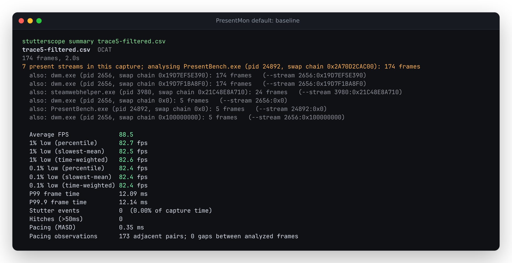
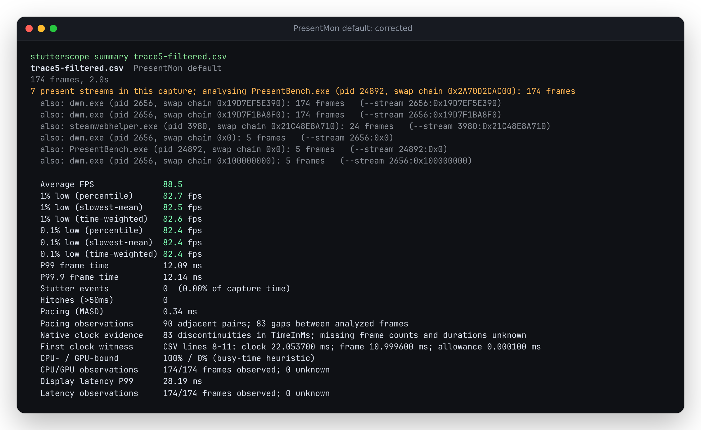

# PresentMon 2.6.0 default metrics

Source baseline `d773224` recognized default PresentMon 2.6.0 output as OCAT.
It retained present durations and stream selection, but discarded CPU/GPU busy
readings and latency, and ignored the default millisecond clock. A filtered
capture therefore connected records that were not adjacent in its original
stream. The correction is now in public source and the live demo; the npm registry
release is separate. [Publication evidence](publication.md) records the build,
canonical public bytes and hosted workflows.
The [direct native example](example.md) now opens this producer replay from a
shareable URL or the landing page, alongside the distinct older gold capture.

## Evidence from the actual producer

The official Windows `PresentMon-2.6.0-x64.exe` processed two upstream ETW
fixtures through WSL. This runs the real offline analyzer, not a CSV generator.
No live game or hardware benchmark was run. [The manifest](manifest.json)
pins the executable, input ETLs, producer source commit, command flags, all
fourteen resulting CSVs and two untouched upstream gold CSVs by SHA-256 and size.
The upstream material is [MIT licensed](UPSTREAM-LICENSE.txt).

The native formats expose different measurements:

```text
present A -------- MsBetweenPresents[B] --------> present B
CPU start A -------- MsBetweenAppStart[A] ------> CPU start B
```

The primary duration remains `MsBetweenPresents`. The default `TimeInMs`
clock compares with the current duration. An explicit CPU millisecond clock
instead compares with the earlier `MsBetweenAppStart`; witnesses identify both
the clock and duration column. Neither CPU duration nor latency is renamed into
present frame time.

The producer's QPC-ms mode has a trap: the `TimeInSeconds` header contains
milliseconds. This is visible in both executable output and
[the native writer](https://github.com/GameTechDev/PresentMon/blob/e13fce6acdb55a808fd8318175a56863e532d95f/PresentMon/CsvOutput.cpp).
The parser uses `CPUStartQPCTimeInMs` with `MsBetweenAppStart` for that mode.
It does not infer the ambiguous header's unit from the numbers. Raw QPC and
local date strings remain unsupported clock bases.

## Results

For the selected PresentBench stream in trace 5:

| Observed quantity | Baseline | Corrected |
| --- | --- | --- |
| Format | OCAT | PresentMon default |
| Retained frames, complete capture | 258 | 258 |
| Usable CPU/GPU pairs | Unavailable | 258 |
| Usable present-to-display latency | Unavailable | 174 / 258 frames |
| Mean present-to-display latency | Unavailable | 22.654643 ms |
| Filtered capture: observed pacing pairs | 173 | 90 |
| Filtered capture: gap boundaries | 0 | 83 |
| Filtered capture: MASD | 0.348243 ms | 0.338631 ms |

The default and QPC-ms filtered inputs agree on all 83 gaps. CPU-only captures
retain CPU readings without inventing GPU or display measurements. The two
`--v2_metrics` controls preserve their complete metric summaries. The new
parser does not infer drops from missing latency; those are separate claims.





[`replay.py`](replay.py) invokes the actual CLI for every fixture. Its oracle
uses Python CSV/Decimal to read the native population, busy pairs and latency.
For filtered captures it locates each unchanged row in the original unfiltered
stream and checks **record ordinal jumps**, independently of native clock
subtraction or the production gap detector. The [baseline receipt](results/before.json)
has 14 discrepancies across 16 inputs; the [corrected receipt](results/after.json)
has zero. Recorded durations, frame populations and FPS remain unchanged where
the old parser already read them.

The browser replay imports default, filtered, QPC-ms and CPU-only captures
offline in Chromium and Firefox at 1440px and 375px. It switches streams,
downloads actual JSON/Markdown reports, applies an interval and recomputes
settings. [Screenshots and download receipts](../../docs/assets/presentmon-default/)
retain the visible source context and channel coverage. The new labelled
synthetic sample is a separate application demonstration, not native evidence.

## Reproduce

From the repository root:

```sh
npm ci
python studies/presentmon-default/replay.py --out /tmp/presentmon-default-replay.json --verify
npm run test:browser -- tests/browser/presentmon-default.spec.js
```

The replay accepts `--cli PATH` for a built or packed-and-installed CLI, and
`--node PATH` to select a verified runtime. It accepts
`--baseline studies/presentmon-default/results/before.json` to additionally
require unchanged v2 metric summaries. The website build is `npm run build`,
with output in `dist/`; `npm run build:cli` produces `dist-cli/`.

[Clean install, package, minimum-runtime and browser verification](verification.md)
records the separate checks, including one existing Firefox scenario that
required an isolated rerun.

Recapture native CSVs on Windows via WSL:

```sh
python studies/presentmon-default/capture.py --cache /tmp/presentmon-default-native --out /tmp/presentmon-default-native.json
```

The script only processes pinned offline ETLs. It never replaces retained
fixtures, and exits 2 for any differing or failed recapture. The first rerender
had a WSL executable-startup failure for trace 1 default and thirteen exact
matches; [the receipt](results/native-rerender.json) preserves that failure.
A [subsequent rerender](results/native-rerender-retry.json) matched all fourteen
CSV byte sequences.
Native replay is not a claim of deterministic output on every host.

## Boundaries

These are short upstream traces, not a sample of current game performance.
Busy-time shares remain a heuristic, and latency definitions differ across
formats. No missing frame count, duration or cause is reconstructed. The
current default's `TimeInSeconds` is deliberately not used as a known-unit
present clock. Older `--v1_metrics`, `--v2_metrics`, OCAT and CapFrameX remain
separate input dialects.

An additional source correction checks native clocks when identity columns
were removed from an edited single-series file; an explicit `--stream` then
refuses to claim a selection without identities. Removing identities from a
multi-process capture does not establish that its remaining rows belong to
one stream.
