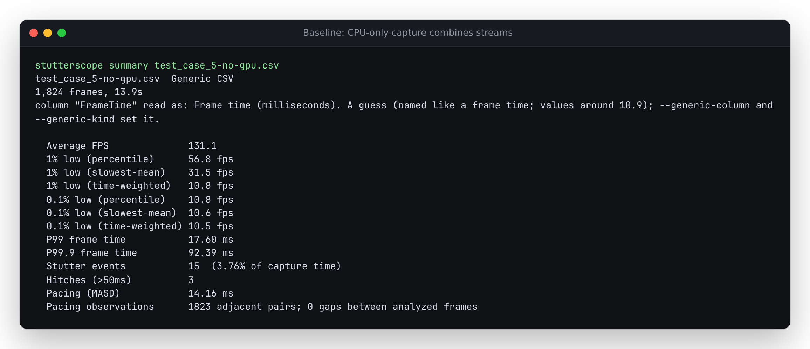
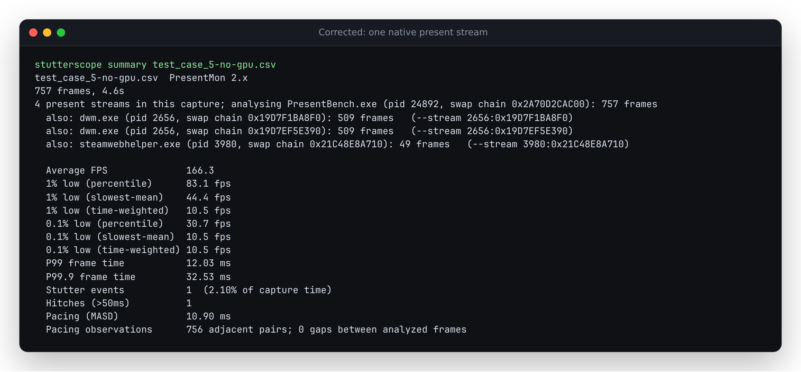
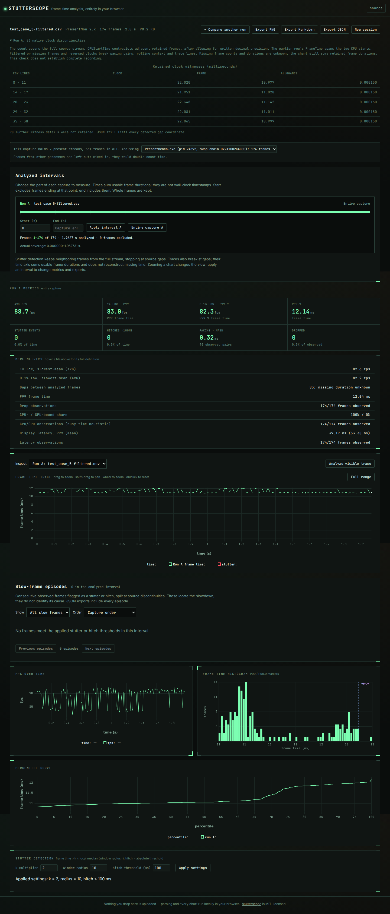

# Native PresentMon 2.x clocks and CPU-only captures

Two defects reproduced on source baseline `0702bd4`, using the official
PresentMon 2.3.0 Windows executable to process upstream ETW trace files.
No live game or hardware benchmark was run. These corrections are local source
changes; the hosted demo and npm 0.2.5 have not been updated by this work.

## What changed

Filtered 2.x captures retained a CPU-start clock, but Stutterscope ignored it
and treated every retained row as adjacent. Its older native clock check is not
directly reusable: [upstream's format definition](https://github.com/GameTechDev/PresentMon/blob/8170aab2b770556b0c4a190602c4448b0cda4a47/README-ConsoleApplication.md#csv-columns)
defines `FrameTime` as a forward duration from the current CPU start to the
next start. The previous row's duration spans a pair of CPU-start readings.
Both `CPUStartTime` and `CPUStartQPCTime` are milliseconds.

```text
CPU start A ---- FrameTime[A] ----> CPU start B ---- FrameTime[B] ----> C
      |                                  |
      +---------- compare clocks --------+
```

The correction detects a longer elapsed interval than the earlier duration,
or a reversed clock, with the existing written-precision allowance. Gaps split
pacing pairs, rolling stutter context, chart connections and slow-frame episodes.
Durations, FPS, percentiles and observed drop outcomes remain recorded values.
Missing frame counts, durations and causes are not inferred.

Separately, valid `--no_track_gpu --no_track_display --no_track_input` output
lacks `GPUBusy`. Detection required that optional column and fell back to
generic CSV, combining unrelated present streams. It now recognizes the CPU
columns and retains normal process/swap-chain selection.

## Before and after

All results below describe retained short trace fixtures, not representative
game performance. Default selection chooses the busiest non-compositor stream.

| Native input | Baseline | Corrected |
| --- | --- | --- |
| Trace 5, filtered, 174 retained PresentBench frames | 173 pairs; no gaps; MASD 0.332474 ms | 90 observed pairs; 83 gaps; MASD 0.317202 ms |
| Trace 1, filtered, 4 retained Presenter frames | 3 pairs; no gaps; MASD 0.830233 ms | 1 observed pair; 2 gaps; MASD 0.144200 ms |
| Trace 5, CPU-only | 1,824 mixed frames; 131.128473 FPS | 757 PresentBench frames; 166.336422 FPS |
| Trace 1, CPU-only | 130 mixed frames; 24.006258 FPS | 17 Presenter frames; 196.727382 FPS |

The six complete default, QPC-millisecond and raw-QPC controls preserve their
entire summaries and source metadata. Four filtered captures change their
adjacency evidence while retaining the other distribution metrics. Two CPU-only
captures change format detection and the measured population.





[Before](results/before.json) has six discrepancies across twelve CLI workflows;
[after](results/after.json) has none. The two clock units give the same pacing
results. The independent oracle identifies each retained row's position in its
original unfiltered stream; it never subtracts clocks or calls the production
gap detector. No missing duration is reconstructed to produce these expectations.



The Chromium and Firefox screenshots at 1440px and 375px are retained in
[`docs/assets/presentmon2-clock`](../../docs/assets/presentmon2-clock/).
They were inspected for overflow and readable source/clock context.

## Reproduce

From the repository root, with Node.js 24 or later and Python available:

```sh
npm ci
python studies/presentmon2-clock/replay.py --out /tmp/presentmon2-replay.json --verify
npm run build
npx playwright test tests/browser/presentmon2-clock.spec.js
```

The replay accepts `--cli path/to/dist-cli/cli/index.js` to test a packed,
installed CLI. The browser workflow imports both native millisecond formats,
recomputes offline, downloads JSON and Markdown, checks witnesses and gap
coordinates, and switches CPU-only streams in both engines at both widths.

[`manifest.json`](manifest.json) pins the executable, two ETL inputs, native
commands and twelve CSV outputs by SHA-256 and size. The executable and traces
are downloaded only for native recapture; fixtures are included for normal
replay. ETLs come from the pinned upstream `Tests/Gold` directory; license:
[`UPSTREAM-LICENSE.txt`](UPSTREAM-LICENSE.txt).

On Windows via WSL, rerun the actual executable with offline `--etl_file` inputs:

```sh
python studies/presentmon2-clock/capture.py --cache /tmp/stutterscope-presentmon2-native --out /tmp/presentmon2-native.json
```

The script writes a receipt and exits 2 if any output bytes differ. It never
replaces the retained fixtures. The retained [complete rerender receipt](results/native-rerender.json)
matches all twelve CSVs. One earlier CPU-only repeat produced extra records
(trace 1: 9,619 bytes versus the retained 9,136); a subsequent complete repeat
matched. The differing full output was not retained, and its cause is unknown.
This does not establish deterministic native output. WSL executable startup
also failed transiently once; an unavailable invocation is not a successful capture.

## Clean install and artifact verification

The [verification receipt](results/verification.json) identifies implementation
commit `a28b4c4`, build-file hashes and the local tarball's integrity hash.

| Check | Result |
| --- | --- |
| Fresh archive, `npm ci`, lint, strict typecheck, unit tests, web/CLI builds | Passed; 394 tests on Node 26.7.0 |
| Unit suite on Node 24.21.0 | 394 passed |
| Complete production browser suite, Chromium and Firefox | 102 passed |
| Twelve native cases through a locally packed, freshly installed CLI on Node 22.6.0 | No discrepancies |
| Earlier native-clock replay | 21 workflows, no discrepancies |
| Pinned public CSV corpus before/after comparison | 34 unchanged outputs: 27 parsed, 7 equal refusals |

The installed CLI's metrics and gap coordinates match the source run. Eleven
witness rounding allowances differ only in their last bits across Node engines,
by at most `2.71e-20` ms; the [exact differences](results/runtime-roundoff.json)
remain inspectable. The tarball keeps version metadata `0.2.5`; it is a local
artifact containing unreleased code, not the registry's existing release.

A [small cached-parse measurement](results/performance.json) recorded medians
of 4.28 ms before and 4.51 ms after on the 104,814-byte native trace 5 control
(647 CSV rows, 258 selected frames). It excludes I/O and analysis and ran
alongside browser checks; it is not a general throughput benchmark.

`npm run build` produces `dist/` with the `/stutterscope/` base.
`npm run build:cli` produces `dist-cli/`. No hosted publication was performed.

## Limits

- Raw `CPUStartQPC` ticks have no frequency in the CSV. Local
  `CPUStartDateTime` strings are not converted into monotonic clocks. Neither
  supports the new duration comparison.
- Missing, coarse or conflicting clock columns can conceal interruptions;
  zero detected gaps does not establish a complete recording.
- The time axis continues to sum retained frame durations. It does not become
  a reconstruction of native elapsed wall time.
- This verifies two retained ETW traces and explicit constructed controls,
  not every PresentMon release, driver, frame-generation mode or device.
- Optional telemetry stays unavailable when its native column is absent.
- These changes have not been published, deployed or released to a registry.
