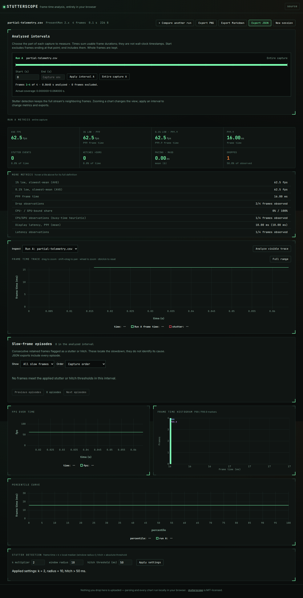

# The public demo now preserves missing observations

On 2026-10-11 UTC, the public demo still served a build that fabricated a hitch
across missing timestamps and counted unknown display outcomes as dropped frames.
Source `b1c33fd` already corrected both. It was independently rebuilt and published
as Pages revision `8b58b10`; the [verification record](results/verification.json)
keeps the full revisions and check scope.

| Hosted input | Before | After |
| --- | --- | --- |
| Controlled browser capture with three deliberately blanked timestamps | 563 frame durations, 3 hitches, 3 skipped rows | 562 durations, the 2 real hitches, 4 skipped rows |
| Four-frame partial telemetry fixture | 3 drops, 75% of all frames | 1 drop, 50% of 2 observed outcomes; 2 unknown outcomes |

The [before capture](results/hosted-before.json) contains actual downloaded
reports from the old hosted app. The [after captures](results/hosted-after.json)
contain eight real worker imports and JSON downloads: both inputs in Chromium
and Firefox, at 1440 and 375 pixels. No page errors, external requests or
horizontal overflow were observed. All four retained screenshots were inspected.

These are existing fixes brought to the public demo, not new metric formulas.
The timestamp fixture deliberately damages a controlled browser-animation
capture; the four-frame telemetry fixture is synthetic. Neither is a game
benchmark or evidence about how frequently telemetry is missing.

## Reproduce the public imports

After installing development dependencies and Playwright browsers:

```sh
node studies/publication/capture.mjs \
  --url https://antonsoo.github.io/stutterscope/ \
  --out hosted-captures.json
```

Add `--screenshots scratch/publication` to capture both inputs at desktop and
phone widths. The checker uses the actual worker, column picker and download
controls. It compares missing-timestamp source lines and observed telemetry
counts; it does not call the parser directly.



## Independent checks and publication

A fresh archive passed `npm ci`, lint, typecheck, all 254 core/CLI checks in
both the normal and comma-decimal locale, production build and 68 browser
workflows. The compiled CLI additionally passed the independent adjacent-row
timestamp oracle and all 199 telemetry cases on Node 26.7.0 and the minimum
22.6.0. The telemetry population is 19 pinned capture files plus 180 deliberate
damage controls, not 199 independent gameplay runs. The
[timestamp](results/timestamp-replay.json), [minimum-runtime](results/timestamp-node22.json)
and [telemetry](results/telemetry-replay.json) receipts retain hashes and scope.
Replay commands and capture provenance remain in the
[timestamp study](../timestamp-gaps/README.md) and
[telemetry study](../telemetry-evidence/README.md).

All **31 served files** matched the verified `npm run build` output in `dist/`.
The [file ledger](results/served-bytes.json) records expected and served SHA-256.
All **68 browser workflows** then passed against the actual public URL, including
CSV rejection, cancellation, stale replies, worker failure/retry, interval
selection, recorded comparison, source-line inspection, JSON/Markdown/PNG
downloads, keyboard interaction and accessibility at phone and desktop widths.

One separate boundary remains at this recorded revision: disconnecting before
the first import prevents the parser worker from loading. The passing offline
interval/export checks imported a capture online first. This publication does
not establish first-import offline support.
The subsequent [first-import correction](../offline-import/README.md) addresses
that separate worker-loading dependency.

No npm release or tag was published; npm still reports 0.2.5. These are local
and hosted checks, not a claim of successful remote CI or ongoing availability.
The records identify the deployed bytes even if the public site later changes.
