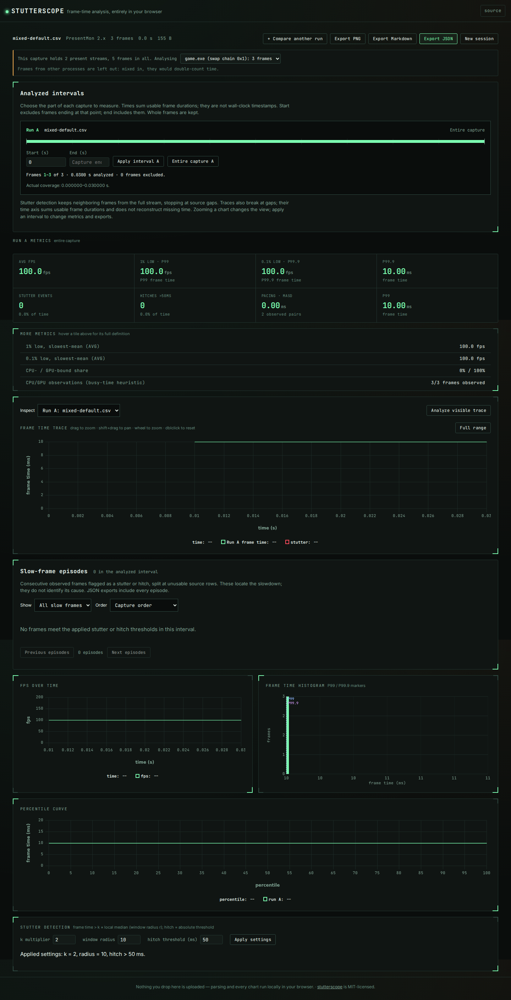

# Keep application identity when process IDs are absent

A five-row **synthetic** PresentMon-shaped CSV exposed a real grouping error.
Removing the `ProcessID` column made the parser ignore `Application` whenever
`SwapChainAddress` remained. Two applications at the same address became one
stream, named after whichever appeared first. This was reproduced against
`b30d55b40dd2592c74b5f37ae13d742c0bbc5526`.

| Selected game | Before | Corrected source |
| --- | ---: | ---: |
| Frames | 5, including the compositor | 3 game frames |
| Average FPS | 45.4545 | 100 |
| Pacing, mean absolute successive difference | 30 ms | 0 ms |
| Stutter events | 2 | 0 |
| Select `dwm.exe` | Error: no matching stream | 2 compositor frames at 25 FPS |

The input is [mixed-default.csv](fixtures/mixed-default.csv): game times
`10, 10, 10` ms interleaved with compositor times `40, 40` ms. The correct
averages follow directly from frames divided by summed frame duration. This
is a controlled counterexample, not a captured game performance result.

Addresses are not a global process identity: Windows gives each process a
[private virtual address space](https://learn.microsoft.com/en-us/windows/win32/memory/virtual-address-space).
Stutterscope now uses the application name together with the swap chain when
the entire PID column is absent. This is still a fallback: two instances of
the same executable can remain indistinguishable without their process IDs.

## Identity and missing observations

| Header has | Identity | Missing cell behavior |
| --- | --- | --- |
| ProcessID, optionally SwapChainAddress | Existing `pid:swap` ID | Missing PID or declared swap chain skips the row |
| Application and SwapChainAddress, no PID | `app:["game.exe","0x1"]` | Missing application or swap chain skips the row |
| Application alone | Application name | Missing application skips the row |
| SwapChainAddress alone | Existing `:swap` ID | Missing swap chain skips the row; process separation cannot be established |
| No identity columns | One series | No per-process identity is available |

A blank cell in a declared column does not trigger the capture-wide fallback.
The parser keeps its physical line number in a warning, excludes its timing
and telemetry, and interrupts all previously observed streams until each
resumes. A skipped frame with a known identity interrupts only its own stream.
`track` and `skip` use the same identity calculation. Source line numbers,
optional channels, and gap flags are filtered together.

There is no reconstruction of process lifetimes, PID reuse, address reuse, or
missing duration. The fallback's application names are case-sensitive for
grouping; name selectors retain their existing case-insensitive behavior.
For repeated application names, `--stream name` still chooses the busiest
matching stream. Keep process IDs in captures when possible.

## Replay

[`replay.py`](replay.py) invokes the actual CLI and imports no application
code. It supplies explicit frame lists, partitions at known missing
observations, and computes expected FPS and pacing with Python rational
arithmetic. Its 55 cases cover the five present-hook formats, application and
swap-chain selection, automatic format detection, invalid times from the same or another application,
blank identity cells, refusal of entirely unassigned inputs, and full-identity
controls. Ten cases agreed before the correction; all 55 agree after it.

```bash
npm ci && npm run build:cli
python3 studies/stream-identity/replay.py --cli dist-cli/cli/index.js --out /tmp/stream-identity.json --verify
node dist-cli/cli/index.js summary studies/stream-identity/fixtures/mixed-default.csv
```

For the baseline receipt, point `--cli` at the baseline's `src/cli/index.ts`
under Node 24 and omit `--verify`. For an installed-package check, point it at
`node_modules/@antonsoloviev/stutterscope/dist-cli/cli/index.js` instead.
[`results/before.json`](results/before.json) retains the original reports,
input text, hashes, expected observations and differing fields.

[`public-controls.mjs`](public-controls.mjs) replays the 34 capture CSVs in the
existing [pinned manifest](../real-captures/manifest.json), verifying each file's
SHA-256 and size first. Summary-only files are excluded. It retains all parser
metadata and metrics, plus byte hashes of frame times, time axes, physical line
numbers, gap flags and optional channels. Cached captures remain unmodified
and are not redistributed by this study. Fetch them using the existing
[public-capture procedure](../real-captures/README.md#reproduce).

```bash
node studies/stream-identity/public-controls.mjs node_modules/@antonsoloviev/stutterscope/dist-cli /tmp/public-controls.json
```

The additional browser workflow imports offline, switches between applications,
downloads reports, checks missing-identity warnings and split episodes, rejects
an entirely unidentified capture, and recovers by importing the valid file.
It runs in Chromium and Firefox at 1440 and 375 px. Production UI code is
unchanged. Screenshots wait for the existing trace entrance animation to finish.

This correction is source-only; the npm package and hosted demo have not been
updated by this work.

## Verified artifacts, 2026-10-12

The final clean archive was made from
`f5beb334c80b73186402828b5b08dff5e47ce7b6`. No production code changed after
that archive. [artifacts.json](results/artifacts.json) binds 98 source, test and
configuration inputs to it and records the package and served-build hashes.

- `npm ci`, `npm run typecheck`, `npm run lint`, `npm test`,
  `npm run build:cli`, `npm pack`, and `npm run test:browser` passed under
  Node 24.21.0. The suite ran 318 tests and 76 Chromium/Firefox workflows.
- The packed package was installed offline outside the source tree. All 25
  package files match the tarball bytes. The artifact is 45,832 bytes, SHA-256
  `0dd5e59f4cf9522ab2db55105afa475bf2f4527898820c67b3550cb69e6e691b`.
- All 55 CLI cases passed on both the declared minimum Node **22.6.0** and
  Node **24.21.0**. Their case records are identical:
  [minimum runtime](results/installed-node22.json),
  [Node 24](results/installed-node24.json). Each entirely unidentified input
  exits 1 with the missing-application reason.
- All 34 pinned public captures (89,496,929 bytes) were hash-checked and
  replayed. The entire [before](results/public-before.json) and
  [after](results/public-after.json) receipts are identical: 27 parse to
  278,107 selected frames; four periodic MangoHud logs are refused by the
  existing clock check and three generic files lack a confident automatic
  column mapping. Those seven are not counted as successful parses.
- All 30 files from the browser build were fetched from the local preview
  server and byte-compared to the tested `dist/`. This verifies the local
  build, not the hosted demo. `npm run build` produces that `dist/` directory.

Actual offline browser downloads are retained for
[Chromium desktop](results/chromium-1440.json),
[Chromium phone](results/chromium-375.json),
[Firefox desktop](results/firefox-1440.json), and
[Firefox phone](results/firefox-375.json). All four screenshots were inspected;
the stream picker, 100 FPS result and flat trace remain visible, and the phone
layout wraps without clipping the controls. No UI styling changed.



[Phone screenshot](../../docs/assets/stream-identity/chromium-375.png) ·
[Firefox desktop](../../docs/assets/stream-identity/firefox-1440.png) ·
[Firefox phone](../../docs/assets/stream-identity/firefox-375.png)

## Throughput cost

[`benchmark.mjs`](benchmark.mjs) measures parsing 430,000 synthetic rows, with
one full warmup and five measured repetitions per runtime/profile, alternating
before/after order and collecting garbage outside each timed parse. It excludes
CSV generation and metrics. The host was WSL2 Linux, 14 available CPUs and
47.0 GiB RAM, using Node 24.21.0. [Raw samples](results/benchmark.json).

| Identity columns / row order | Before median | After median |
| --- | ---: | ---: |
| PID present, one stream | 186.5 ms | 192.4 ms |
| PID present, alternating two streams | 225.5 ms | 240.4 ms |
| No PID, one application | 175.6 ms | 168.1 ms |
| No PID, alternating two applications | 210.3 ms | 375.5 ms |

The last case costs more because the corrected parser constructs application
and swap-chain tuple IDs and filters the selected stream; the baseline merged
all 430,000 rows incorrectly. The corrected result retains the 215,000 game
frames. These are local throughput observations, not latency guarantees or a
claim that the repair improves performance.

```bash
node --expose-gc studies/stream-identity/benchmark.mjs /path/to/baseline/src /path/to/installed/dist-cli /tmp/stream-benchmark.json
```
