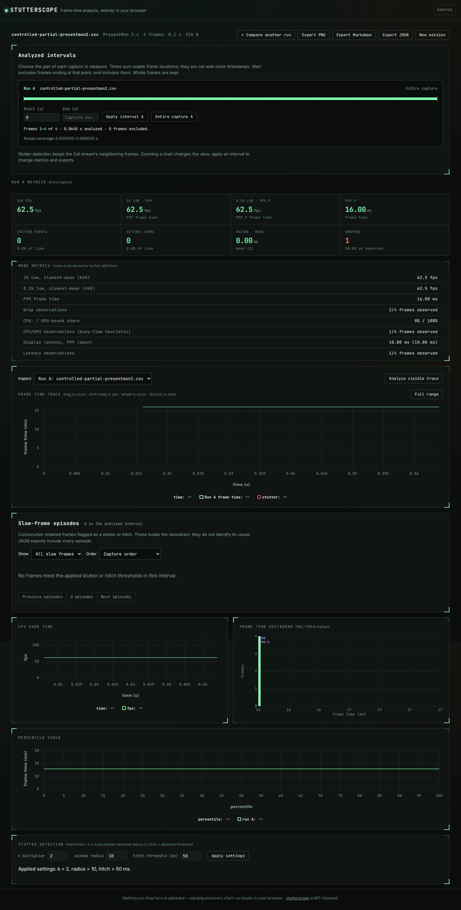

# Optional telemetry evidence, 2026-10-09

A frame time can be usable while the same row's display or GPU measurements
are missing. The source checkout now keeps those states separate. Unknown
display outcomes neither increase drops nor dilute their observed fraction;
missing columns do not claim zero. CPU/GPU and latency estimates carry the
number of frames that supplied their inputs.

This work is local and unreleased. The baseline is `4997beb`; the retained
results came from the actual source, built browser worker and installed npm
tarball. No telemetry was uploaded, and the synthetic controls are not game
benchmarks or evidence about how often captures are damaged.

## A four-frame example

[`controlled-partial-presentmon2.csv`](../../examples/telemetry/controlled-partial-presentmon2.csv)
contains four 16-ms frames. The first has a displayed duration and busy/latency
measurements. The second explicitly says `NA` for displayed time. The third
has a malformed displayed-time cell, and the fourth has a blank one.

| Observation | Baseline | Current |
| --- | --- | --- |
| Dropped count | 3 | 1 |
| Dropped fraction | 75% of all four frames | 50% of two observed outcomes |
| Unknown outcomes | Not represented | 2 |
| GPU-busier share | 100%, denominator not shown in UI | 100%, 1/4 frames observed |
| Display latency P99 | 10 ms, sample count absent | 10 ms, 1/4 frames observed |
| Select only frames 3-4 | Two inferred drops | Unknown drops; unavailable busy/latency estimates |
| Average FPS | 62.5 | 62.5, including in the unknown-only interval |

The distinction follows PresentMon's definition: its
[v2.3.0 column documentation](https://github.com/GameTechDev/PresentMon/blob/v2.3.0/README-ConsoleApplication.md#csv-columns)
assigns `NA` specifically to frames that were not displayed. Other missing or
unusable text does not establish that outcome. The
[legacy CSV writer](https://github.com/GameTechDev/PresentMon/blob/v1.10.0/PresentMon/CsvOutput.cpp)
writes explicit `0` or `1` flags. The numeric flag rule also applies to OCAT,
CapFrameX, FrameView and explicitly mapped generic CSVs; their source references
and format limitations remain in [formats.md](../../docs/formats.md).

| Source cell | Internal drop channel |
| --- | --- |
| Explicit numeric flag `0` / `1` | Displayed / not displayed |
| PresentMon 2 `DisplayedTime = NA` | Not displayed |
| PresentMon 2 finite duration at least zero | Displayed |
| Blank, missing, malformed, negative duration, other flag value | Unknown (`2`) |
| No applicable column | Channel absent |

`N/A` is unknown in `DisplayedTime`; the documented not-displayed marker is
`NA`. Non-finite and negative busy or latency samples are excluded, while zero
is observed. Both CPU and GPU values must be valid on the same frame. The
CPU/GPU split remains a busy-time heuristic, with ties assigned to CPU as
before; it does not identify a causal bottleneck.

## Independent replay

[`run.py`](run.py) verifies cached capture bytes against the existing pinned
[manifest](../real-captures/manifest.json), generates missing-data controls,
and calls [`replay.mjs`](replay.mjs) against an explicitly selected source tree
or installed `dist-cli`. A separate Python CSV calculation checks counts,
observed fractions, paired busy values, latency P99 and coverage.

| Inputs | Files/cases | Selected frames | Baseline cases with disagreements | Current |
| --- | ---: | ---: | ---: | ---: |
| Pinned public capture files | 19 | 113,333 | 6 | 0 |
| Constructed missing/invalid telemetry | 180 | 11,520 | 177 | 0 |

The public files comprise 18 PresentMon gold fixtures (three output variants
of six ETL traces) and one 57.4-MB FrameView example. They are **not 19 independent
gameplay runs**, nor a random sample. Each file retains only the parser's selected
process/swap-chain stream for this comparison. The Python reference filters
raw rows by that selected stream identifier and independently reads their
frame times and telemetry; dedicated tests separately check stream selection
and interval slicing.

All six changed public files are the unversioned PresentMon gold CSVs. They
have capitalized `MsBetweenPresents` columns and follow the existing OCAT-family
parse path, but have no `Dropped` column. The old checker reported zero drops;
the current checker reports no available dropped metric. This does not add
support for every other column in those files. The other 13 public files agree
with the reference before and after.

The 180 controls rotate through all six formats with drop channels, including
missing columns, all-unknown flags, zero values and damaged durations. Their
error counts demonstrate the constructed failure modes, not real-world error
rates. Baseline coverage was absent, so the baseline disagreement count compares
the numeric results alone. Current coverage is additionally checked in full.

Retained results: [baseline](results/before.json), [current](results/after.json),
[installed Node 26.7.0](results/installed.json), and
[installed Node 22.6.0](results/installed-node22-replay.json). Each records
input hashes, pinned source URLs, the reference and observed outputs, and any
disagreements. The installed CLI's [summary](results/installed-cli.json) and
[comparison](results/installed-comparison.json) were run from outside the
checkout; the comparison's B interval has zero observed outcomes.

The largest selected stream has 112,316 frames. Its parse and metric calculation
took 423.5 ms before and 431.2 ms after in the retained Node 26.7.0 replay on
this 14-logical-CPU, 48-GB WSL2 Linux workstation. Those are single observations,
excluding file read/decoding, not a statistically controlled benchmark or a
claim of a speedup. The raw timings for every input are retained.

## Browser and export behavior

The browser test uploads the controlled CSV through the real worker, checks
the displayed drop count and observed denominators, downloads JSON and
Markdown, then applies `0.032` seconds to capture end. The two remaining frame
times still contribute to FPS while all three optional estimates are unavailable.
Both Chromium and Firefox produce the expected download contents, retained in
[`docs/assets/telemetry/*-downloads.json`](../../docs/assets/telemetry).



Desktop and 375-pixel screenshots in that directory were visually inspected.
The existing large-capture comparison checks initially caught a narrow-screen
overflow in the longer coverage text; moving the heuristic qualifier into the
wrapping label fixed it. The tests and overflow assertions were retained.

Browser/comparison JSON now uses **schema version 4**. The metric values remain
in `metrics`, and `metrics.telemetryCoverage` distinguishes an absent column
(`null`) from a present column with no usable observations. Partial entries
hold `observedFrames` and `unknownFrames`; their sum equals the selected frame
count. Dropped percentages use the observed count, so consumers must not assume
the whole capture is their denominator. The flat summary CLI JSON keeps its
existing shape and adds the same coverage object.

Coverage does not count invalid frame-time rows, excluded streams, or frames
never recorded. It is not a confidence interval and does not make a one-frame
latency estimate representative. PNG cards still contain frame-time metrics
for A; optional telemetry is in JSON/Markdown and the review screen.

## Reproduce

From a checkout, install with `npm ci`. The public capture cache can be restored
with `python studies/real-captures/fetch.py` (network required; pinned inputs).
The replay itself makes no network requests:

```bash
mkdir -p /tmp/claude-1000/stutterscope-telemetry/before
git archive 4997beb src | tar -x -C /tmp/claude-1000/stutterscope-telemetry/before
python studies/telemetry-evidence/run.py \
  --src /tmp/claude-1000/stutterscope-telemetry/before/src \
  --out /tmp/claude-1000/stutterscope-telemetry/baseline --observe-only
python studies/telemetry-evidence/run.py --src src \
  --out /tmp/claude-1000/stutterscope-telemetry/current
npm run build:cli
node dist-cli/cli/index.js summary examples/telemetry/controlled-partial-presentmon2.csv
node dist-cli/cli/index.js summary examples/telemetry/controlled-partial-presentmon2.csv --start 0.032
npm run build
UPDATE_TELEMETRY_SCREENSHOTS=1 npx playwright test
```

Source replay uses native TypeScript on Node 26.7.0. For the declared minimum
Node 22.6.0, select compiled `dist-cli` and pass its executable through `--node`.
The actual 22.6.0 binary used here came from the official Node archive, verified
against its published SHA-256 checksum before execution.

Validation: fresh install, clean lint/typecheck, 218 core/UI/CLI tests, 56
production-browser scenarios, both builds, and installed-package replays.
The production site builds with `npm run build` into `dist/`. No registry or
hosted site was updated.
