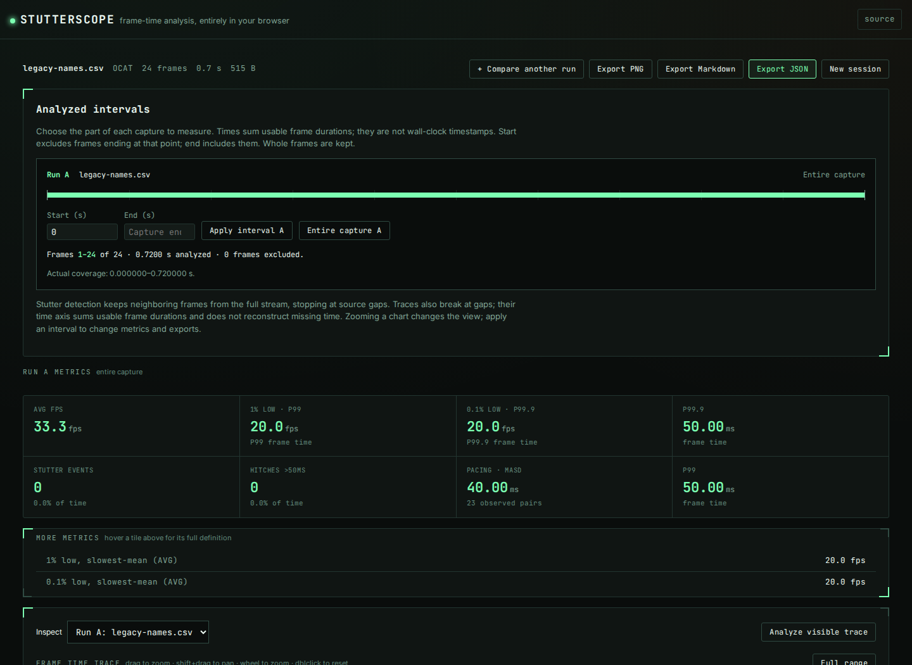
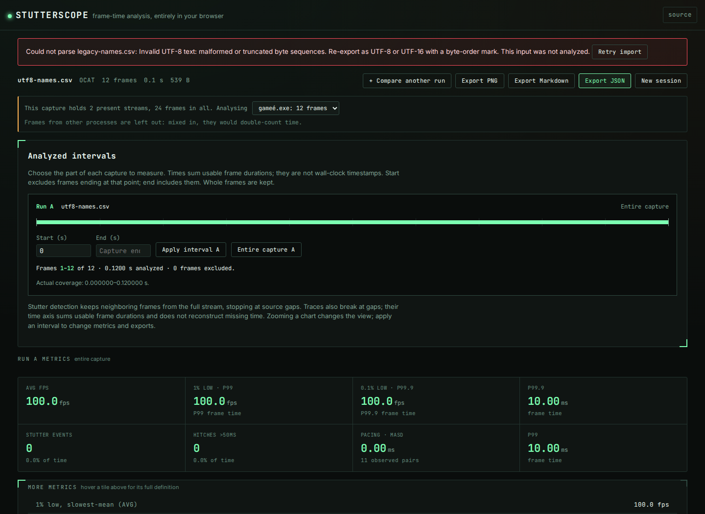

# Invalid bytes can merge two applications into one FPS report

At source baseline `fd04e5f`, both import paths used permissive text decoding.
Different invalid byte sequences became the same replacement character before
stream selection. A synthetic OCAT-column CSV with Windows-1252 application
names `gameé.exe` and `gameè.exe` therefore became one `game�.exe` stream.
Interleaved 10 ms and 50 ms frames produced **33.33 FPS and 40 ms MASD**, with
24 frames, no skipped rows and no warning. The two independent streams actually
have 100 FPS and 20 FPS; mixing their durations is not a meaningful capture.

The corrected source rejects the unsupported encoding before accepting a
report. Re-exporting the same text as UTF-8 preserves two streams and selects
the first 12-frame, 100 FPS stream by default. These are constructed byte-level
counterexamples, not evidence that OCAT emits Windows-1252 or damaged captures.
This change is source only, not an npm release or live-demo deployment.

## Retained executable evidence

[`generate.py`](generate.py) defines the bytes, and [`cases.json`](cases.json)
pins all 23 specimens by size and SHA-256. [`replay.py`](replay.py) invokes a
built or installed CLI as a child process. It records stdout/stderr behavior,
exit status, stream identities, metrics and normalized full-report hashes.
Only the CLI report's input path is normalized to `<capture>`.

| Input group | Cases | Baseline | Corrected source |
|---|---:|---|---|
| Windows-1252 application names | 1 | Collapsed names; 33.33 FPS, 40 ms MASD | Exit 1; no report |
| Invalid UTF-8, including late damage and truncated final sequences | 8 | Accepted | Exit 1; no report |
| Invalid UTF-16LE/BE: lone high/low surrogates and odd final byte | 6 | Accepted | Exit 1; no report |
| Valid UTF-8, UTF-8 BOM, both UTF-16 byte orders, literal U+FFFD | 5 | Accepted | Identical reports |
| Valid UTF-8/UTF-16 characters split across the 64 KiB preview | 3 | Accepted | Identical reports |

The [baseline](results/before.json) meets 8 of 23 expected outcomes; the
[corrected CLI](results/after.json) meets all 23. All eight accepted controls
retain identical full-report hashes. The rejection checks require exit 1 and
empty stdout, rather than treating any crash or usage failure as success.
The actual `compare` command also [rejects damaged input in either slot](results/compare.json)
with exit 1 and no stdout.

The [public capture manifest](../real-captures/manifest.json) pins the existing
corpus. After excluding three summary files, the runner hash-checks and invokes
the CLI on 34 cached captures. [Before](results/corpus-before.json) and
[after](results/corpus-after.json) records are identical: 27 accepted and seven
existing refusals (unsupported Afterburner files and periodic MangoHud logs).
Every accepted normalized full report and every refusal message is unchanged.
This is compatibility evidence for that corpus, not proof of every format or
an estimate of how often damaged exports occur.

## Actual offline browser imports

[`browser.mjs`](browser.mjs) opens the production build in Chromium and Firefox
at 1440 px and 375 px. Each workflow byte-compares its five successful startup
assets to the build, stops the HTTP server, goes offline, loads a valid control,
then imports all 23 specimens through the actual file input and exports JSON.
It uses the real worker and parser. For report comparisons, only the browser
export's `generatedAt` field is removed.

All four baseline workflows accepted the 15 invalid inputs. All four corrected
workflows refuse them while preserving the preceding valid capture and its
complete exported report. A failed comparison import also preserves the
previous single-run report; importing the valid control again recovers it.
The receipts retain every specimen's observed source and report hash:
[baseline](results/browser-before.json), [corrected](results/browser-after.json).




The [375 px Chromium](../../docs/assets/text-integrity/after-chromium-375.png),
[desktop Firefox](../../docs/assets/text-integrity/after-firefox-1440.png) and
[375 px Firefox](../../docs/assets/text-integrity/after-firefox-375.png)
screenshots were also inspected. No horizontal overflow, page errors, external
requests, CSP violations or axe WCAG 2 A/AA and 2.1 AA violations were observed.
Automated accessibility checks are not complete accessibility verification.
Firefox attempted two local font requests after going offline in each workflow;
they were unavailable, and the app used its fallback fonts. There were no late
non-font requests. The narrow viewport requests a light OS preference; the
app's existing dark interface remains unchanged.

## Why the preview needs different finalization

Both CLI and browser use fatal decoding. Complete imports flush the decoder,
so an unfinished final UTF-8 sequence, UTF-16 code unit or surrogate pair is an
error. The browser reads a 64 KiB sample to identify the format. That sample is
explicitly partial only if more bytes remain in the file; an incomplete final
character is deferred to the full import. Malformed interior bytes still fail.
A complete file of exactly 64 KiB must validate its final character immediately.

The core checks stream each specimen in seven-byte chunks, splitting UTF-8
sequences and UTF-16 units/pairs. They compare complete parsed series, ensure
reader locks are released, and verify that a failing cancellation cleanup does
not hide the original decoding error. Whole-file and streamed paths agree.

Strict decoding applies even to unused columns: invalid bytes cannot be safely
interpreted as the capture's intended text. Legacy encodings are not guessed.
Re-export as UTF-8 or UTF-16 with a byte-order mark. Correctly encoded U+FFFD is
allowed; if a file was already damaged and re-saved as valid Unicode, this check
cannot recover its original identities or detect that history. Valid Unicode
alone does not establish that the capture is complete or physically correct.

## Clean archive and installed package

The [verification receipt](verification.json) records a fresh archive of
implementation `0b710e1`: all 353 tracked files stayed byte-identical through
installation and checks. Node 24.21.0 completed `npm ci`, lint, type checking,
343 core checks in each of the default and German locales, both builds and
76 Chromium/Firefox checks. The
[core](results/clean-tests.txt), [German-locale](results/clean-tests-de.txt)
and [browser](results/clean-browser.txt) logs are retained with the temporary
archive path normalized. All 30 clean web-build files matched the build used
for the offline observations above. All generated screenshots were inspected.

The local npm tarball is 46,207 bytes, SHA-256
`bcd66f853873a37c1db0b558a4f00615481542d8c44722c33904a1c831b0fcef`.
It was installed in a separate directory with lifecycle scripts disabled;
all 22 compiled runtime files matched the clean build. All 23 cases agreed
with the intended outcomes on both the declared minimum
[Node 22.6.0](results/installed-node22.json) and
[Node 24.21.0](results/installed-node24.json), with the same reports as the
corrected source. The installed executable also completed normal summary and
interval-comparison commands on the existing synthetic samples.

After the archive run, the replay runner was tightened to require the explicit
`Invalid UTF-` error in addition to exit 1 and empty stdout. Replaying the
baseline, corrected source and both installed runtimes preserved every retained
observation. No runtime code changed after the clean checks. Package version
remains 0.2.5; neither the tarball nor the web build was published.

## Reproduce

```bash
npm ci
npm run build
python3 -I studies/text-integrity/replay.py dist-cli/cli/index.js --label checkout
python3 -I studies/text-integrity/replay.py dist-cli/cli/index.js --label checkout --corpus
node studies/text-integrity/browser.mjs --build dist --output /tmp/stutterscope-text-evidence --after
```

`npm ci` prepares the compiled CLI. The corpus command needs the existing
hash-pinned cache; use `python3 -I studies/real-captures/fetch.py` if absent.
The fixture replay needs no external capture downloads. Its JSON includes
`disagreements`; zero is the required corrected outcome. For installed checks,
pass the installed `dist-cli/cli/index.js` and optionally `--node /path/to/node`.

To reproduce the baseline, build `fd04e5f` in a separate checkout and pass its
compiled CLI and web output to these runners. Omit `--after` for the baseline
browser observation. Browser binaries must already be installed for Playwright;
the runner never downloads them.
