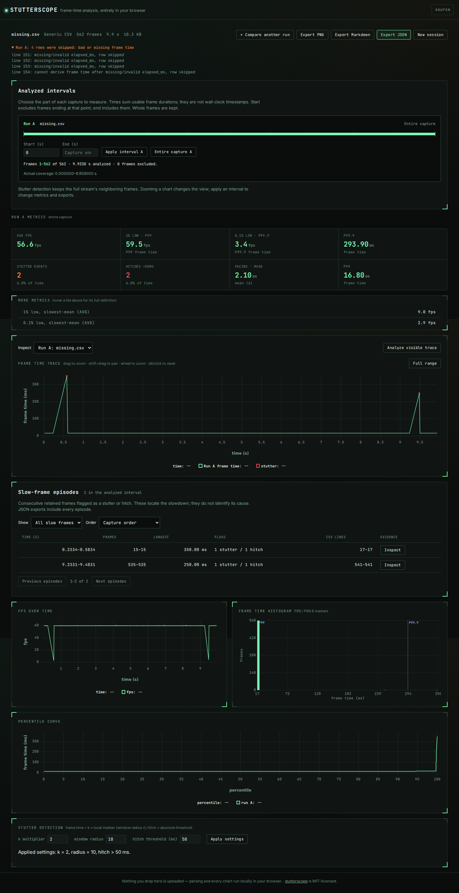

# Missing timestamps are not a long frame

The baseline `124f67e` differences each valid cumulative timestamp from the
previous valid one, even when intervening records are missing timestamps. That
combines several unknown frame durations into one apparent hitch.

This example starts with the retained [Chromium capture B](../../examples/controlled-browser/README.md).
`complete.csv` projects its `frame` and `elapsed_ms` columns. `missing.csv` blanks
the timestamps of frames 150, 151 and 152, keeping their records. This damage is
deliberate; the original browser capture did not contain missing timestamps.
The replay verifies every cell against the original capture and its SHA-256.

| Input | Baseline frames / hitches | Corrected frames / hitches | Skipped rows after fix |
| --- | --- | --- | --- |
| Complete timestamps | 566 / 2 | 566 / 2 | 0 |
| Three missing timestamp cells | 563 / 3 | 562 / 2 | 4 |

The fabricated 66.6 ms frame ended at CSV line 154. Its duration actually spans
four captured frame intervals. The fix leaves all four intervals unknown,
reports lines 151-154 as skipped, and resumes differencing at line 155. The two
real hitches remain at CSV lines 17 and 541. The initial timestamp establishes
the clock and has no frame duration in either version.

## Reproduce

```sh
npm ci
python3 studies/timestamp-gaps/replay.py --out /tmp/timestamp-gaps.json --verify
```

The dependency-free Python verifier executes the compiled CLI and independently
subtracts **adjacent CSV rows**, requiring both timestamps to exist. It compares
frame counts, summed duration and hitches above 50 ms. `--cli` accepts an installed
package's `dist-cli/cli/index.js`; `--node` selects a runtime. The verifier itself
does not simulate frame times or call the Stutterscope parser.

- [Baseline receipt](before-124f67e.json), [corrected build](after.json).
- [Installed package](installed.json), [minimum Node 22.6.0](installed-node22.json).
- [Browser downloads](browsers.json) from Chromium and Firefox, each at 1440 and
  375 pixels. The real worker, column picker, warning panel and JSON download
  are exercised. There were no page errors or horizontal overflow.
- [Capture corpus replay](corpus-after.json): all 34 existing inputs have identical
  status, metrics and warnings to the [previous corpus receipt](../csv-integrity/results/corpus-after.json).

The installed tarball was built locally, not released to npm. Its SHA-256 was
`a0e2600a671e6f88d1f80108fe0c4635f04bfc7859f020b84e7cab7df3a4f8b0`.
Every compiled JavaScript module's hash is retained in the replay receipts;
source-build and installed receipts agree. Validation also passed lint,
typecheck, 254 unit/CLI checks and 68 browser checks on Node 26.7.0.

To regenerate the screenshots and exported browser reports:

```sh
npm run build
npm run preview -- --host 127.0.0.1 --port 4194 --strictPort
# In another terminal:
node studies/timestamp-gaps/observe-browser.mjs
```



## Boundaries

This fix cannot recover the missing durations or distinguish their causes.
It cannot detect a record that was removed entirely: no frame-sequence column
is interpreted. Entirely blank lines remain formatting, not observations.
Per-frame duration inputs remain independent; an invalid row does not discard
the next valid duration. Repeated timestamps and backwards-clock restarts keep
their existing behavior. The timeline still sums usable frame durations and
does not reconstruct elapsed wall time across gaps. Episode grouping and local
stutter windows still operate on retained frames.
